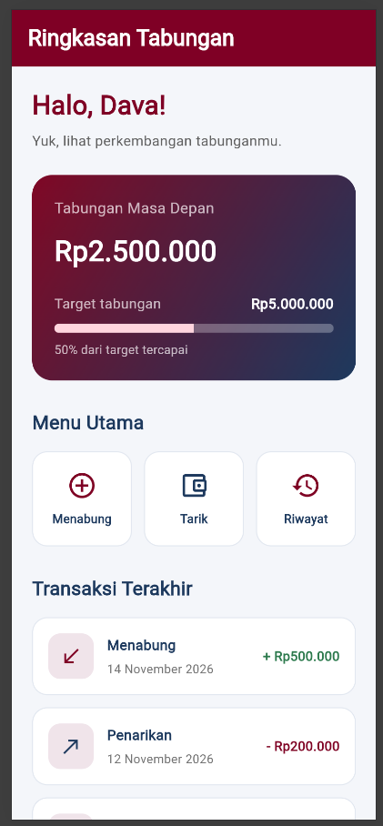
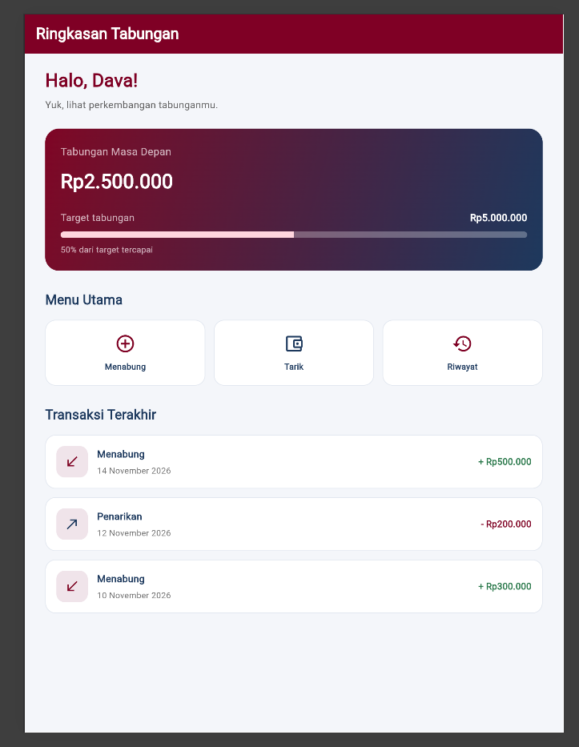

# TabungKu – Aplikasi Ringkasan Tabungan

## Identitas

- **Nama:** Ahmad Dava Rifai
- **NIM:** 20240801056
- **Mata Kuliah:** Pemrograman Mobile
- **Tugas:** Minggu 3 – Menyusun Layout dengan Widget Dasar Flutter

## Deskripsi Aplikasi

TabungKu merupakan aplikasi sederhana berbasis Flutter yang menampilkan ringkasan informasi tabungan. Aplikasi ini dibuat untuk menerapkan penggunaan widget dasar Flutter dalam menyusun tampilan antarmuka yang rapi dan responsif.

## Fitur

- Menampilkan ringkasan saldo tabungan.
- Menampilkan target dan progres tabungan.
- Menyediakan menu Menabung, Tarik, dan Riwayat.
- Menampilkan daftar tiga transaksi terakhir.
- Menggunakan kombinasi warna burgundy dan biru.

## Teknologi

- Flutter
- Dart
- Material Design

## Widget yang Digunakan

- `Scaffold` dan `AppBar`
- `Container` dan `Padding`
- `Column` dan `Row`
- `Text` dan `Icon`
- `SizedBox`
- `Expanded`
- `SingleChildScrollView`
- `ConstrainedBox`
- `LinearProgressIndicator`

## Cara Menjalankan Aplikasi

1. Pastikan Flutter sudah terpasang.
2. Clone repository:

   ```bash
   git clone https://github.com/Ahddvarfai/tabungku_layout.git
   ```

3. Masuk ke folder proyek:

   ```bash
   cd tabungku_layout
   ```

4. Unduh dependency:

   ```bash
   flutter pub get
   ```

5. Jalankan aplikasi:

   ```bash
   flutter run
   ```

## Pengujian

Pemeriksaan kode dilakukan menggunakan:

```bash
flutter analyze
```

Hasil: **No issues found!**

Pengujian aplikasi dilakukan menggunakan:

```bash
flutter test
```

Hasil: **All tests passed!**

## Screenshot Aplikasi

### Tampilan HP



### Tampilan Tablet



## Repository

[GitHub – TabungKu](https://github.com/Ahddvarfai/tabungku_layout)
